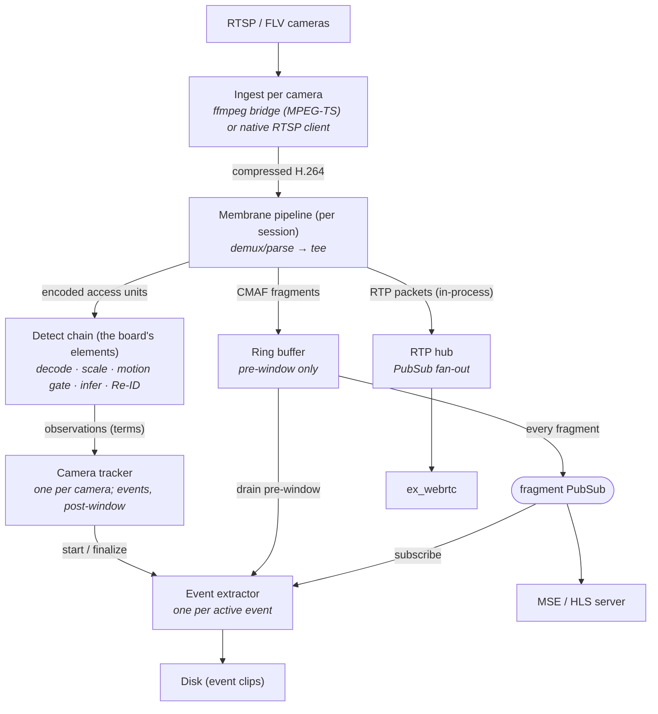

# NVR Architecture

This document describes the architecture of an Elixir-based NVR (Network Video Recorder) designed to run on resource-constrained hardware (e.g. QCS6490, Rockchip SBCs) while supporting multiple IP cameras, real-time inference, low-latency live preview, and event-based recording.

The design optimizes for three goals, in this order:

1. **Predictable resource use.** No unbounded memory growth, no surprise CPU spikes from things the user didn't ask for.
2. **One supervision tree.** Media, detection and event lifecycle all live in the BEAM. There is no process-management inventory — no UDP port allocation, no cross-process epoch fencing, no wire protocol between the host and its own detector. (The external-plugin architecture this replaced is archived in `docs/archive/plugin-contract.md`.)
3. **Operational robustness.** Cameras drop, networks blip, processes crash. The system self-heals without operator intervention, and the failure domain of each piece is explicit.

## High-level overview



Three planes still meet only at well-defined boundaries, but they now share one VM:

- **Encoded video plane.** One ingest session per camera delivers compressed H.264 into the camera's long-lived Membrane pipeline, which fans it out three ways without ever decoding for display: CMAF fragments to the ring, RTP packets to the WebRTC hub, encoded access units to the detect branch. Cairn is codec-copy end to end for everything a human watches.
- **Inference plane.** The detect branch decodes and infers through native libraries the node loads, on dirty schedulers: a decode library and an engine library, both the board's choice (on the generic board `cairn-native` and `cairn-ort`, each linking `plugins/cairn-detect`'s stage library). Compressed access units go into the decoder, decoded frames pass between the branch's elements as buffer payloads (or, where a board keeps them on the device, as dma-buf leases), and observation terms come out of the engine.
- **Event plane.** Detection aggregation, event lifecycle, and clip extraction consume from the other two via PubSub and produce files on disk.

## Ingest

A camera's connection lifecycle — connect, loss, reconnect with a jittered 1 s → 30 s backoff — belongs to whatever owns the socket, never to a supervisor: a dead camera is a normal long-lived state. Where that owner sits is the only difference between the two ingests:

- **ffmpeg bridge** (default). `Cairn.FFmpegPort` owns one supervised ffmpeg per camera as a dumb demuxer: RTSP (or vendor FLV-over-HTTP) in, **MPEG-TS on stdout** out — a container with pts, which the Fragment timing and the ObservationClock need. It stays *outside* the pipeline so a pipeline crash cannot take the camera's backoff state with it; the bytes reach `Cairn.Pipeline.BridgeSource`, resolved through `Cairn.Registry`. ffmpeg is kept for its two decades of camera-vendor workarounds; it no longer fans out, transcodes for consumers, or touches UDP.
- **native RTSP** (`ingest: rtsp`, per camera). `Membrane.RTSPDualStream.Source` owns the client sessions *inside* the element: the `rtsp` library handles socket/depayload/digest/keepalive and delivers whole access units with pts, and the element reconnects on its own. There is no FFmpegPort for that camera at all. Quirky cameras keep the ffmpeg bridge — the flag is per-camera and reversible.

Either way a session's end is in-band (`StreamClosed`), and the stream epoch is minted from the media itself by `Cairn.Pipeline.EpochTagger` as the next session's first buffer is produced — never by the process that owns the connection.

Non-H.264 cameras: Cairn probes and warns. Opt-in `transcode: true` uses hardware `h264_v4l2m2m` inside the bridge only — there is deliberately no software fallback, and RTSP-native ingest refuses transcode (there is no ffmpeg in that chain).

### The long-lived pipeline

`Cairn.PipelineOwner` starts one `Cairn.Pipeline.Camera` (Membrane) per camera and monitors it — deliberately **not** a supervisor child, so that a crash-looping pipeline backs off instead of burning supervisor intensity. It is rebuilt for exactly two reasons: it died, or the owner's watchdog found a wedge (detect branch stale behind a healthy ring; ring stale while the source reports itself connected — for a bridge camera only after an `FFmpegPort.bounce/1` fails to clear it). A mere outage rebuilds nothing: the source reconnects underneath.

Topology: source (`BridgeSource` or `RTSPDualStream.Source`) → TS demux (bridge only; RTSP carries pts natively and the source declares its own format from each session's SPS) → `EpochTagger` → tee →

1. **Recording branch**: `SessionCut` → CMAF muxer → `RingBufferSink`, shaping each segment into a `Cairn.Fragment` (pts from the segment's own `tfdt`, timescale from the init header, `keyframe?` = first sample is a sync sample). The muxer survives neither a session's pts reset nor an identical-SPS reconnect, so the gate ends its branch's stream on `StreamClosed` — which is also what flushes the muxer's held tail into the ring — and the owner links a fresh branch immediately.
2. **RTP branch**: `SessionCut` → RFC 6184 payloader → in-process `push_packet/2` into `Cairn.RTPHub`. No sockets anywhere; per-session too, which is what gives each session its own ssrc.
3. **Detect branch**: picker (backpressure, keep-newest depth-1, refuses to emit across a dropped-AU hole until the next IDR) → the board's chain (`Cairn.Pipeline.DetectChain`; on the generic board `Decoder` → the motion gate when the camera has one → `Inference`, one unit in flight between each pair, `Decoder` and `Inference` being the NIF call sites; on the Rockchip release with `decoder: rkmpp`, `DecodeScale` → `Download` in `Decoder`'s place, each a NIF call site as well) → `ObservationStamper` (the observation clock, and the per-batch tracking context resolved from config + the runtime overlay) → `Membrane.MOTTracker` (the generic tracker element hosting the core the config names — `Cairn.Tracker` by default) → `TrackSink` (tagged objects, lifecycle events and a checkpoint snapshot → `Cairn.Detect.Dispatch` → the camera's `CameraTracker`, which owns the event lifecycle and nothing else). Absent when the camera names no `plugin:`. Never per-session: the decoder's and inference's native state is the expensive half, and it is exactly what a reconnect must not cost — the epoch rides buffer metadata instead, and `Inference` reopens its stream when it changes.

## Detection: the in-VM engine

`cairn-detect`'s stages (decode/hwdecode, motion gate, inference, Re-ID embedder) are one Rust library with four consumers: the standalone binary (the generic board's canary, the parity harness, board benches), the `cairn-native` NIF that decodes, the `cairn-ort` NIF that infers, and the Rockchip board's crate. They cannot diverge — same crate, same code. The library's motion gate survives as the parity reference only: a live camera's gate is `Cairn.Pipeline.MotionGate`, an Nx element between decode and inference.

- **One engine, one model per node.** Config load refuses groups whose profiles ask for different models. The engine's model config comes from the hardware profile the camera's `plugins:` group names.
- **Dirty schedulers, errors as values.** Decode and inference entry points run on dirty schedulers; per-stream faults (decode errors, a failed inference) return as values and stay contained to that stream. `catch_unwind` guards the NIF boundary.
- **Blast radius, and what buys it down.** A NIF panic restarts the whole node — the accepted cost of not running a second BEAM (measured: 0 faults in 83k + 110k soak inferences before acceptance). Model load is the known crash/wedge vector, so `Cairn.Native.Canary` probe-loads any new or changed model in a **throwaway OS process** before the NIF is allowed to load it. The executable is the board's choice per backend, and links the same stages the engine does: `cairn-detect` in group mode for `ort` and `qnn`, `cairn-rockchip-probe` for `rknn`.
- **Health is probed, not inferred.** `Cairn.Native.Health` is its own process that calls the host under a deadline it imposes from outside (ORT/QNN offer no per-call deadline); the ratio check distinguishes a wedged NPU (nothing completing) from saturation (slow but faster than CPU). A wedge is an operator alert, never a restart loop — no restart at any level recovers a wedged NPU. `Cairn.Native.Status` maps engine and per-camera verdicts (including refused hardware decoders) onto the same `cameras:status` surface everything else reads.
- **Per-SoC hardware axis.** Decode candidate + NPU runtime per family (QCS6490: Venus/v4l2 + QNN; RK3566, in the Rockchip release: MPP + RGA (`rkmpp`) + RKNN; RK3576 not measured) — the table is `docs/npu-backends.md`. A profile that *names* a hardware decoder is refused if the decoder falls back to software: silent degradation is this system's recurring defect class, and the detect branch going dark (recording intact, reason on status) beats detecting nothing at 15× the CPU.
- **Teardown discipline.** Native destructors are deferred to a drain thread; `Cairn.Native.Drain` starts first in the app tree (so it terminates last) and drains them bounded at shutdown, keeping VM halt from racing accelerator deinit.

## Boards

Everything that differs between SoC families — the decoders and NPU runtimes on offer, the elements in a camera's detect branch, the profiles that ship — belongs to a **board**, and a node runs exactly one. Three layers:

- **`libs/cairn_stage`, the contract.** `Cairn.Stage.Board` is the behaviour a board implements. `Cairn.Stage.Step` and `Cairn.Stage.Chain` say what a detect chain is and check one. `DecoderNif` and `EngineNif` are the behaviours a board's NIF modules meet, `FrameMeta` and `DmaFrame` the frame formats that pass between elements. `SampleGate` and `DecoderCore` are the sampling rule and the decode element's lifecycle, held here so every board's decoder behaves alike. The library depends on Membrane and on nothing of Cairn's.
- **The base, `:cairn`.** Everything else in this document, and the generic board (`Cairn.Board.Generic`): decode through `cairn-native`, ONNX Runtime and QNN through `cairn-ort`.
- **A board library under `boards/`.** Today `boards/cairn_rockchip`: its elements (`DecodeScale`, `Download`), its NIF crate over MPP, librga and RKNN, its probe binary and its profiles. Its Elixir depends on `cairn_stage` and never on the base. The base libraries it reuses are lent to it by name in `config/boards/rockchip.exs`: the generic decoder and engine, for a camera that does not ask for `rkmpp` and a backend that is not `rknn`, and the decoder host, which its own decode element opens through as well. Its Rust crate is the exception to that separation: it has path dependencies on `plugins/cairn-detect` and `plugins/cairn-ort`.

`CAIRN_BOARD` (default `generic`) picks the board a release is built with. `mix.exs` adds the board library as a dependency; `config/config.exs` imports `config/boards/<board>.exs`, which names the board module; `Cairn.Board` reads that name at compile time, as its default; and the Dockerfile's runtime stage is `vendor-<board>`. A board attached at boot from a board directory replaces the default (see [Board directories](#board-directories)).

### What a board answers

| Callback | Answers |
|----------|---------|
| `name/0` | The board's name; config errors carry it |
| `detect_chain/1` | The steps of one camera's detect branch (below) |
| `decoders/0` | The `decoder:` names a profile may use |
| `backends/0` | The `backend:` names, each with its capabilities: the `model:` key naming its artifact, whether NMS may be fused into the graph, whether shapes are dynamic, whether the CPU baseline needs an FP32 twin, whether it is experimental (absent means it is), and, for a backend whose artifact is converted from the export, which decode contracts the conversion was measured to detect on |
| `decoder_backend/1` | The decode NIF module behind a decoder name |
| `engine/1` | The engine NIF module behind a backend name, and the canary executable that probe-loads a model for it |
| `preflight/0` | Which of those names cannot work on this host, and why (a missing device, library or NIF) — a profile naming one is valid and would do nothing |
| `artifacts/1` | Runtime files the release does not carry, which the base fetches at first start and keeps only if they hash to the pinned sha256 |
| `profiles_dir/0` | Where the board's shipped profiles are |

### The detect chain

`detect_chain/1` returns a camera's detect branch as a list of `%Cairn.Stage.Step{}`: the element to build, its child name, the stages it `covers`, and its `input` and `output` format tags (`:h264`, `:rgb`, `:dma_frame`, `:detections`). The base hands it a context holding the camera's id and stream parameters, its resolved `decoder:` name, its motion gate config, and `generic` — the base's own steps for that camera — so a board can keep any of them without depending on the base.

The generic board returns `generic` unchanged: `:decoder` (H.264 in, RGB out) → `:motion_gate` when the camera has one → `:infer`. The Rockchip board, for `decoder: rkmpp`, replaces the decode step with two of its own and keeps the rest: `:decoder` (`DecodeScale`: H.264 in, a frame in a dma-buf out) → `:download` (dma-buf to RGB) → the base's gate and `:infer`. Inference is the base's element on every board; which engine it reaches is `engine/1`'s answer.

`Cairn.Pipeline.DetectChain` checks the list with `Cairn.Stage.Chain.validate/2` before anything is built from it, and a chain that fails raises at pipeline build, naming the rule:

- the chain is a non-empty list of `%Step{}` with unique names;
- every covered stage is one of `decode`, `scale`, `motion`, `infer`, each covered at most once and in that order;
- every required stage is covered — `motion` only when the camera configured a gate, since a board that dropped it would detect on every frame the operator asked to skip;
- the first step takes `:h264`, the last emits `:detections`, and each step's output is the next step's input.

**A fused element is declared by its step's `covers:` list, and nowhere else.** An element doing two stages' work lists both — `Cairn.Pipeline.Decoder` and `Cairn.Rockchip.DecodeScale` each cover `[:decode, :scale]` — and an adapter that only converts between formats covers none (`Download`). The check reads the declaration, not the element: nothing verifies that an element does what its step claims. A wrong list passes, and misleads the next reader of the chain — the Rockchip board itself finds the base step to replace by looking for `:decode` in `covers`.

### Adding a board

A second board, `boards/cairn_foo`, needs:

1. A Mix project depending on `cairn_stage` only: a module implementing the nine `Cairn.Stage.Board` callbacks, its NIF modules (`EngineNif`, and `DecoderNif` if it decodes) written to load without their library, and its profiles under `priv/profiles`.
2. `config/boards/foo.exs`, naming the module and lending it whichever base libraries it reuses.
3. A `board_deps/1` clause in `mix.exs`.
4. In the image: a `vendor-foo` runtime stage; its library, NIF and profiles copied into the release-build stage, which names `boards/cairn_rockchip` by path today and checks the Rockchip release for the last two; a vendor-libraries stage if it needs vendor userspace; a branch in `tools/container/build-rust-aarch64.sh` if it has a Rust crate; its canary executable on the PATH.
5. In `.github/workflows/container.yml`: the `board` option and its add-on mapping, with a `deploy/vagus-addon/<addon>/config.yaml`.
6. In CI: an entry in the sobelow and dialyzer matrices, a test job compiled with `CAIRN_BOARD=foo`, a job for the library standing alone, and the five Rust gates for its crate.

A board that brings a new backend registers it from its own crate: a `Descriptor` (name and capabilities) and a `Provider` that opens it, handed to `cairn_detect::cli::run` by its probe binary and to `Engine::with_provider` by its NIF. `plugins/cairn-detect` names only the backends it opens itself, `ort` and `qnn`. Whether a backend is experimental, and which decode contracts its conversion is proven for, the board declares in `backends/0`; the base reads both through `Cairn.Stage.Capabilities`.

### Board directories

`CAIRN_BOARD_DIR` names a directory holding a board built apart from the release. `Cairn.Board.Loader` attaches it in `Cairn.Application.start/2`, before the supervision tree starts, and `bin/cairn eval` attaches it on the first `Cairn.Board.module/0`. Empty or unset means the built-in board.

```
<dir>/board.manifest
<dir>/lib/<app>-<vsn>/ebin    the .app file and the beams
<dir>/lib/<app>-<vsn>/priv    NIF libraries, profiles
```

The manifest is three Erlang terms, each once: `{app, cairn_rockchip}.`, `{board, 'Elixir.Cairn.Rockchip.Board'}.` and `{contract, 1}.` The board application's version is its `.app` `vsn`; the directory may hold other applications beside it.

A board's Mix project writes its directory with `mix cairn_stage.board --core-rel <release>/releases/<vsn>/cairn.rel --out <dir>`, after it compiled, in the environment it ships from. The board module is the project's `cairn_board:` key in `project/0`; the contract is `Cairn.Stage.contract/0`. The task walks the board application's `applications` and `included_applications` through the build's `.app` files, judges each against the core release's `.rel`, and writes nothing if anything fails:

- An application the `.rel` lists is not written, and its version in the board's build must equal the `.rel`'s. Versions are compared, never bytes: the same version builds differently in another checkout.
- An application the `.rel` does not list is written, with its dependencies. One the build lacks, an OTP or Elixir application, is taken from the toolchain.
- An application in none of these places is refused, unless it is optional for the application that needs it. So is the board application itself in the `.rel`, a dependency on `:cairn`, an ERTS other than the `.rel`'s, a `defimpl` of a protocol the directory does not ship, and an `--out` that exists and is neither empty nor a previous board directory.

Attaching checks the contract number against `Cairn.Stage.contract/0`, then appends every `lib/*/ebin` to the code path and loads every application with all its modules, which runs each `on_load`. It requires the board application to be the directory's copy, runs `Cairn.Stage.Conformance.check/2` on the board module, handing `detect_chain/1` the base's own steps as `generic`, and only then records the board. `:cairn`'s start then starts the board application. Any failure stops the boot: `start/2` returns `{:error, {:board, message}}`, the log reads `Application cairn exited: … returned an error: {:board, "…"}`, and the VM halts with OTP's `application_start_failure` slogan carrying the same message.

A board obeys these rules:

- It depends on `cairn_stage`, on applications the release ships, and on applications its directory carries, never on `:cairn`. Its application starts inside `:cairn`'s start, before `:cairn`'s tree, so it cannot use `:cairn`'s processes; a dependency on `:cairn` would hang the boot, and the loader refuses it.
- It is started `:permanent`: a board application that fails to start, or exits later, halts the node.
- It is built for this release's contract number. A different number is refused, naming both, before any board code is on the path; an engine library that loaded must report the same number from `contract/0`. One that did not load is never opened: the host refuses it by name.
- An application the release already ships is not taken from the directory: the release's copy is loaded first and is the one that runs. A board application the release ships is refused.
- `backends/0` offers `ort` and `decoders/0` offers `auto`: the base's shipped profile and its defaults name them, so the loader refuses a board without either.
- A NIF module that fails its `on_load` refuses the boot. One whose absence should not stop the node loads without its library and reports through `load_error/0`.
- It implements no protocol the release ships: the release's protocols are consolidated, so a board's `defimpl` of one never dispatches. The task refuses it.
- The directory is trusted code. Every application under `lib/` is loaded and every `on_load` runs with the node's privileges, in an eval VM too, so the directory must not be writable by the service's user. The contract number is a compatibility check, not a signature.

`test/fixture_board` is a board built this way, with a stub NIF and no hardware; `tools/ci/build-fixture-board.sh` writes its directory. `tools/ci/board-boot-test.sh`, CI's `board-loader` job, boots the prod release with it attached, and with broken copies of it that must be refused. `tools/ci/external-board-test.sh`, CI's `external-board` job, builds it outside the tree from this commit by git alone — `cairn_stage` as a sparse Mix git dependency with its lock seeded from core's — boots the release with it, and checks that `cairn-detect` and `cairn-ort` taken by Cargo git dependencies at one ref resolve to one copy each, and to two when the ref is spelled two ways.

## The ring buffer

Unchanged in role: a per-camera GenServer holding `pre_window_seconds` of fmp4 fragments in memory, evicting by media time, broadcasting each fragment on PubSub, and serving `drain_and_subscribe/3` atomically (drain + subscribe in one call, which is what makes the pre-window race-free for extractors).

Memory is bounded by `pre_window × bitrate × camera_count`, independent of event duration. Fragments are refc binaries: every subscriber holds a pointer, not a copy. The init segment carries the session epoch; fragment `seq` is restamped 0-based per ring so consumers survive session resets.

## The camera tracker

Event lifecycle is owned one camera at a time: a `Cairn.CameraTracker` in that camera's own `Cairn.Camera.Lane`, fed observations by the detect branch through `Cairn.Detect.Dispatch` — plain functions in the caller's process, so no per-frame GenServer hop and no config-server call on the frame path (policy is resolved at session start and on refresh). The dispatch resolves the tracker's Registry name per batch and casts; it holds no pid and no monitor, which is why a lane worker's restart is invisible to the media and a batch cast into the gap is merely dropped.

The tracker assigns identities itself (`Cairn.Tracker`: IoU + optional staged admissions — BBD, ORU, OCR, Re-ID fusion — per the profile's stage list), debounces detections into events, and keys suspend/adopt off **stream epoch identity**: one epoch is one continuous decode session, so nothing (pts, object continuity) carries across a respawn except by the tracker's own adopt-across-reset rule. Trackers are `:transient` and checkpoint to ETS, so a crash restores in `init/1`; a camera disabled or deleted stops its tracker, which finalizes an open event on the way out.

## The event extractor

One `Cairn.EventExtractor` per active event; the only component writing permanent storage. It drains the pre-window atomically, then streams live fragments, writing nothing until the first keyframe-headed fragment (which becomes the clip's t=0), and finalizes into the SQLite index on post-window quiet. Fragmented mp4 keeps unfinalized files playable up to the last complete fragment; `remux_clips: true` rewrites the finished clip so it knows its own duration.

Extractors are `:temporary` under `Cairn.EventSupervisor`, not in the camera tree: they are scoped to an event, so they outlive a lane owner's crash and the replacement re-adopts them from its checkpoint. The clip is ended by its **owner** — the lane worker that opened it, passed in as `owner:` at start and re-claimed with `owner/2` after an adoption. That worker has been updating the event's labels, scores and trigger ever since, and the snapshot the extractor holds is stale from the first detection, so a self-close would persist the opening metadata and emit no `:event_ended`. The extractor therefore monitors the ring its subscription came from and, when that ring dies, only *reports* it — `{:ring_lost, event_id}` to its owner, which answers with its ordinary finalize. The single close it performs itself is the orphan: owner dead, nothing left to cast, so it closes with what it has rather than hold an `:active` row forever.

## Live view

- **WebRTC** (default), for sub-second latency: `Cairn.RTPHub` broadcasts the pipeline's RTP packets per camera and replays the last GOP to each new viewer for an instant first frame; `ex_webrtc` peers do SRTP. A player whose signalling or ICE fails reports it, and the dashboard flips that camera to MSE — the fallback is the error path, since a browser that speaks WebRTC can still sit behind a network that drops the media.
- **MSE** over a Phoenix channel: init segment, then fragment binaries into a `SourceBuffer`. Latency ≈ one fragment duration. The dashboard's per-camera toggle picks it explicitly ("Standard").
- **HLS** fallback: a playlist generator over the same ring state, used where `MediaSource` is missing.

Detection boxes are drawn over the live feed by LiveView, not by a canvas hook: `Cairn.Pipeline.PresenceSink` publishes each inferred frame's detections on `Cairn.LiveDetections`' node-local per-camera topic, and `CairnWeb.DashboardLive` renders absolutely-positioned components from the already-normalized boxes. Each message replaces that camera's whole list, so an empty one is how boxes disappear. Playback overlays are the other mechanism — `TrackOverlay`'s canvas over the per-event sidecar — because a recording needs the box that belongs to the frame the operator seeked to.

## Configuration and reload

`config.yml` is the source of truth. A **hardware profile** (one YAML per board class) names the model, input geometry, backend, fps band and tracker stage list; a `plugins:` group is a profile reference, and every camera naming that group detects on it. Config load expands the profile into the engine's model config and the host's tracking policy from one file, so the two halves cannot disagree.

On reload, the new config reaches the engine first (`Cairn.Native.Host.reconfigure/1` — a model change is handled there, not by restarting cameras), then the camera diff. It sorts each camera into exactly one of `added`, `removed`, `rebuilt`, `changed` and `refreshed`, and the tests are in that order because the coarser answer subsumes the finer:

- **`changed`** — an edit that reaches a subprocess, the ring, or a detect-branch element built from it: `rtsp_url`, `substream_url`, `plugin`, `min_score`, `ingest`, `transcode`, `extra_ffmpeg_args`, `motion_json`, and the *resolved* pre-window, tracker core, sample rate, live-track cap and ladder rung. None of them is readable into a running session, and none is consumed by a lane worker — so the camera's `:media` subtree is replaced and everything else stands.
- **`rebuilt`** — the resolved capability tier, and only that. It picks the detect branch's tail *and* which event workers the camera runs, and no running supervisor can be edited into a different child list, so the whole tree is stopped and started.
- **`refreshed`** — everything else the running camera was handed: the camera struct and its effective policy, including a *global* window or tracking edit that moves neither. It is cast into the running tree.

The contract for a field added to `Cairn.Config.Camera` later is refresh-only; nothing joins the restart list by being new.

## Process supervision tree

```
Cairn.Supervisor
├── Cairn.Native.Drain             (first, so its terminate runs last: drains native teardown)
├── Cairn.Repo / Ecto.Migrator     (SQLite event + track index; the Repo reads data_dir off the file itself)
├── Cairn.Config.Server            (after the migrated Repo, so a source may read rows; everything below hangs off it)
├── Cairn.Registry
├── Phoenix.PubSub / Cairn.CameraControl / Cairn.CameraStatus
│                                  (a rest_for_one group: both tables subscribe to config in init/1)
├── Cairn.EventCheckpoint          (node-level ETS: each tracker's open event)
├── Cairn.PresenceSupervisor (rest_for_one)
│   ├── Cairn.PresenceCheckpoint   (each recorder's open event)
│   └── Cairn.PresenceLedger       (announced presence keys; a checkpoint crash empties it too)
├── Cairn.EventSupervisor (DynamicSupervisor)
│   └── Cairn.EventExtractor       (one per active event, temporary)
├── Cairn.StreamEpochs             (before the cameras that mint epochs into it)
├── Cairn.Native.Host              (the one engine; outside camera trees so a camera
│                                   restart never reloads the model)
├── Cairn.Native.Health            (its own process: probes the host under a deadline)
├── Cairn.Native.Status            (maps engine health onto cameras:status)
├── Cairn.CameraSupervisor (DynamicSupervisor)
│   └── Cairn.Camera (one per camera, one_for_one)
│       ├── :media Cairn.Camera.Media (rest_for_one; replaced alone on a restart-class change)
│       │   ├── probe              (ffprobe task, temporary)
│       │   ├── Cairn.RingBuffer
│       │   ├── Cairn.FFmpegPort   (bridge cameras only: the ffmpeg Port)
│       │   ├── Cairn.PipelineOwner (the camera's long-lived Membrane pipeline)
│       │   └── Cairn.RTPHub       (socketless; fed by the pipeline's RTP branch)
│       └── :lane  Cairn.Camera.Lane  (one_for_one; the event workers, transient and
│           checkpoint-restoring, composed by the resolved tier — tier 1:
│           Cairn.PresenceRecorder then Cairn.PresenceAggregator; every other
│           tier, including an unprofiled camera's nil: Cairn.CameraTracker)
├── Cairn.Retention / CairnWeb.WebRTC.Supervisor / Cairn.Boot
└── CairnWeb.Endpoint
```

The two per-camera subtrees are independent — the media reaches the lane only by resolving a Registry name and casting — so `Cairn.Camera` is `:one_for_one`, and a lane worker crash-looping past its intensity does not bounce the camera's RTSP connection. What the child order decides is the **stop**, which runs in reverse: `:media` first means the lane goes down first, while its ring is still live and its pipeline has not yet published the camera's `:camera_stopped` epoch. That is what the lane's `terminate/2` needs — the tracker and the recorder each cast a finalize to an extractor still draining a live ring, and the tracker gets to end its live tracks `:camera_stopped`, which is what actually happened to them. Stopping the media first inverts it: the epoch arrives as a message and ends every track `:stream_reset`, counting a reset that never happened. The cost of this order is at the start, and it is a batch or two cast to absent names and dropped.

Inside `:lane`, the recorder starts before the aggregator — against the data's direction, and decided by a read that happens once. `Cairn.PresenceAggregator.init/1` clears its predecessor's announced keys and deletes those ledger rows; the recorder's `adopt_announced/1` reads the same rows to find a presence that began while the lane was down. Read after the aggregator has run, they are gone and the whole stay goes unrecorded. Neither `init/1` calls the other — only casts — so the order costs no deadlock, and reverse-order shutdown still stops the aggregator first, into a live recorder's mailbox.

`Cairn.Camera.Media` stays `:rest_for_one` because there the dependency is real: ring death restarts the ingest (a fresh ring is empty anyway), and ingest death restarts only its downstream consumers. The pipeline itself is *not* in the tree — `Cairn.PipelineOwner` monitors it and its jittered backoff (not supervisor intensity) owns the "camera is down" state, as `Cairn.FFmpegPort`'s does for the bridge.

Escalation is three-level: `Cairn.Camera.Media`'s intensity, then `Cairn.Camera`'s (which restarts `:media` alone), then `Cairn.CameraSupervisor`'s, which rebuilds the whole tree. The `:camera` Registry name survives the first two, so a camera whose media is crash-looping still counts as running to `sync/1`. The third level is why `Cairn.Camera.init/1` resolves its camera and config from the config server's published snapshot, falling back to the opts pair only when no snapshot names it: a `Cairn.Camera` is a `:permanent` child of a DynamicSupervisor and its stored child spec cannot be rewritten, so a tree rebuilt from those baked args alone would revert to the camera's pre-change restart-class fields and stay there. The baked args are the tree's identity, not its configuration.

The node-level tables sit outside every camera tree, and the lane workers **outlive** them: an aggregator being fed batches must not die because the ledger's ETS table went with a crashing owner, so each table's API reads a missing table as an empty one — a `get/1` answers `nil`, a `delete/1` `:ok`. The reverse also holds: what a restarted aggregator owes the world is not its state but the `presence_cleared` events its predecessor's announcements are still waiting on.

How each diff class lands on the tree:

- **`refreshed`** — `Cairn.PipelineOwner.refresh/3` for `:media`, then a refresh cast to every lane worker (absent names dropped; the tier is not re-read here, the tree already answered that question).
- **`changed`** — `:media` is terminated, deleted and started again from the new camera; the restart-class fields are baked into its children's arguments, so a `restart_child` would rebuild from the old struct. The lane runs on through the gap and is handed the new pair immediately afterwards, because the `%Cairn.Config{}` each worker holds is what it passes to every extractor it starts.
- **`rebuilt`** — stop the whole tree, and let `sync/1` start it again from the new config so the lane is built for the new tier.
- **`removed`**, and a disable, which produces the identical diff — the tree is stopped. Nothing distinguishes them here, and nothing should: what differs is state, and the checkpoint, status and control tables prune against the diff's `known` ids (which include the dormant), so a disabled camera's rows survive for re-enable and a deleted camera's do not.

A media replacement **splits** an open clip rather than preserving or losing it. The ring is inside `:media` and the extractor's subscription lives in the ring's own state, so no replacement inherits it; the extractor reports `{:ring_lost, _}` to its owner, the owner closes with the *current* event, and its retry — or the next qualifying batch — opens a fresh clip on the new ring. A reconnect is the case that differs: the ring is ahead of the pipeline in `Cairn.Camera.Media`, so it survives one and the clip runs unbroken. One residual: `Supervisor.start_child/2` appends, so a replaced `:media` sits after `:lane` and a later whole-camera stop tears it down first — which costs the track *labels* (`:stream_reset` instead of `:camera_stopped`), not the clip. OTP cannot reorder a spec in place, and moving `:lane` would restart the workers the split exists to keep alive.

Three rules every lane child obeys, each of them a real defect found in review:

- **No `Cairn.Config.Server` call from `init/1`.** A reload or UI edit runs `apply_diff → sync → start_child` *inside* the server's `handle_call`, so a child that calls the server during init waits on a server waiting on it. Config comes from the published snapshot, or from the pair the tree passed in.
- **Both `config:` and `owner:` into every extractor it starts.** Without `config:` the extractor calls the config server itself — the same deadlock through a second door, since a restore-driven open happens in `init/1`. Without `owner:` a lost ring is only logged and the clip starves until its window runs out.
- **Gate the open on a live ring.** The lane outlives its media, so `:media` can be mid-restart under it — a ring crash restarts the ingest chain, a restart-class change replaces the subtree outright — and a restore- or retry-driven open landing in that gap would die `:noproc` and leave a junk `:partial` event. No ring, no clip: arm the retry instead. Both the name and `Process.alive?/1` are checked, because "`Cairn.Registry.whereis/2` does not filter dead pids, and the single partition's DOWN handling can lag a read arbitrarily — so a corpse answers here for a while after a media replacement". A ring that dies *after* the check is not the gate's business: the extractor reports the loss.

## Resource budget

Approximate budget on QCS6490 for 4 cameras at 5 MP H.264, 20 fps (the measured wall — Venus refuses a fifth concurrent 5 MP decode session outright):

| Resource | Usage | Notes |
|----------|-------|-------|
| Ingest CPU | ~1% per camera | codec-copy demux only |
| Decode + scale | ~8% + ~25% of a core per camera at 5 fps sampled | hardware decode via v4l2m2m; GPU-side scale (`gles` feature) cuts convert ~4× where Mesa works |
| Inference | ~6% of the NPU session per camera at 5 fps | QNN p50 ~12.5 ms/pass; the shared model session serializes |
| BEAM CPU | <5% idle, more with viewers | mostly SRTP |
| Ring RAM | pre_window × bitrate × cameras | fixed |
| Disk | 0–4 MB/s during events | ~3 GB/event-hour/camera at 4 Mbps |

The scaling dimensions on that board: **decode+scale** is the per-camera cost that caps camera count (inference is not — measured ~80 passes/s available against 5/s per camera), and **disk** dominates long retention.

RK3566 is the other way round: **inference is the cap.** The engine's one RKNN context carries about 18 passes/s on YOLOX-tiny 416 and under 8 on YOLOX-s 640, so at the 2 fps floor (1.875 passes/s per camera) the measured boundary is nine cameras on the first and four on the second, with the NPU itself about half idle and MPP decode and the RGA scale far from their limits (`docs/evidence/rk3566-capacity-20261118.md`). Those runs drove the pipeline without the application around it: at nine cameras the VM peaked at 217 MB RSS and the whole system averaged 34 % CPU.

Capacity and fps bands are measured per SBC and recorded in that board's profile; x86 is a test host and never gets a measured band.
